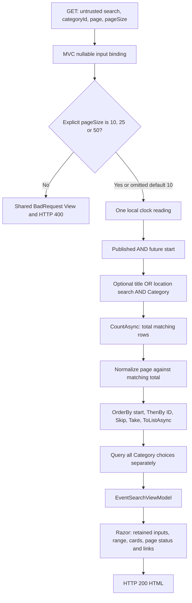

# Lesson 03 — Exercise deliverables

## Retrieval contract

Captured request:
`/Events?search=Pagination%20Practice%20Workshop&categoryId=1&pageSize=25&page=2`.
Category 1 is Academic in the private verification database; IDs must be read
from the actual database rather than assumed in other environments.

The captured request returned 25 rows but a matching count of 52: the View
displayed Showing 26–50 of 52 events and Page 2 of 3. Request criteria are
transient, not new Event columns. The View derives the range from normalized
page state and actual returned row count. Pagination links retain search,
Category and size; the GET form omits page, starting new criteria at page 1.

Browser-only filtering would first require transferring unrelated or private
rows, would not bound database materialization and would not enforce the public
eligibility rule at the server. The controller composes those predicates before
SQL execution and Razor only receives the selected page.

## Defect report: ordering and request state

An uncommitted experiment removed `.ThenBy(eventItem => eventItem.Id)` and
removed only `asp-route-pageSize="@Model.PageSize"` from Next. The private
practice dataset contains equal-start pairs, including Workshops 01 and 02.

The displayed order of those first pairs happened to remain unchanged in this
run. Without the secondary key, SQL provides no unique total order within ties;
different query plans or concurrent data changes can move rows across page
boundaries. A stable-looking small run does not prove deterministic ordering.
Test approach: arrange equal-start IDs, compare adjacent pages against the
start/ID order and check for omissions/duplicates on a fixed dataset.

The Next defect was directly observed: page 1 used size 25, but its href was
`/Events?search=Pagination%20Practice%20Workshop&categoryId=1&page=2`.
Following it defaulted to size 10 and showed Showing 11–20 of 52 events instead
of Showing 26–50 of 52 events. Search and Category survived; page size did not.

Both expressions were restored. The corrected Next href includes
`pageSize=25&page=2`, and the browser again showed 25 cards and Showing 26–50
of 52 events. Executed SQL again ordered by StartDateTime and Id before
OFFSET/FETCH. No defective implementation is retained in the commit.

## Independent regression boundary

`Index_OmittedPageSize_DefaultsToTenAndReturnsSecondPage` uses a fixture-owned
migrated SQL Server database and a fixed UTC-04 clock. It arranges twelve
eligible matching Events plus one starting exactly at the captured now.

Prediction for an omitted size and requested page 2: TotalCount 12,
CurrentPage 2, PageSize 10, TotalPages 2, and rows Default Boundary 11 and 12.
The exact-now row must not match. These assertions passed in the final suite.

The direct action test supplies bound arguments itself, so it cannot establish
MVC query binding or Razor HTML. The retained HTTP cases cover malformed input;
browser checks additionally observed size selection, rendered ranges and links.
Each test database is disposed through the unchanged Lesson 2 fixture.

## Decision record: offset versus keyset

Assumptions: CEMS has a classroom-sized catalog, requires numbered pages and
First/Last navigation, and uses a chronological start/ID order. A larger feed
would prioritize continuous forward browsing with frequent inserts.

| Criterion | Current offset pagination | Cursor/keyset pagination |
| --- | --- | --- |
| Direct page access | Supports arbitrary page numbers | Requires a known continuation key; arbitrary jumps need extra design |
| Last navigation | Count and normalized final-page offset | Reverse traversal or a separate final-page query is needed |
| Query cost | Deep offsets can scan/discard many rows; count is separate | Indexed continuation can avoid deep offsets; counts remain separate work |
| Concurrent inserts | Earlier inserts can shift offsets between requests | A start/ID cursor reduces earlier-insert shifts; it is still not a snapshot |
| URL | search, categoryId, page, pageSize | search, categoryId, size and validated start/ID cursor |
| Complexity | Matches current model and UX | Adds cursor validation, reverse navigation and UX changes |

Recommendation for CEMS today: retain offset pagination, because it satisfies
the required UX with the current data volume. Counterargument: very deep pages
can become costly even though returned rows are bounded. Next experiment:
measure logical reads and latency for representative first, middle and deep
pages, including the count query, before changing the design.

Recommendation for a large activity feed: evaluate indexed keyset continuation
on `(StartDateTime, Id)` if arbitrary page jumps and Last are no longer required.
Counterargument: keyset alone does not freeze results across requests or provide
the present page-number contract. Compare both approaches under controlled
concurrent inserts and define consistency expectations first. No production
refactor or new database index was introduced by this exercise.
