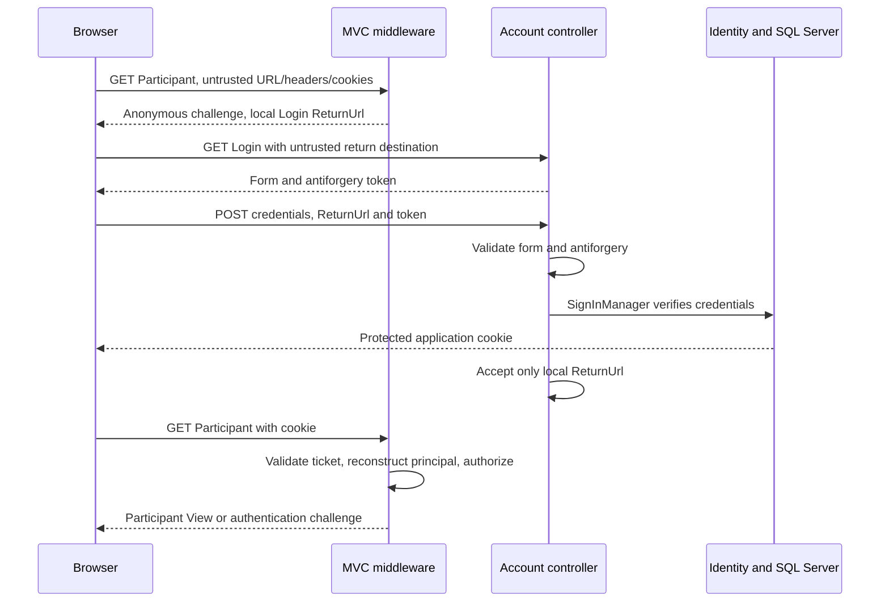

# Lesson 04 — Exercise deliverables

## Trust boundary

A redirect does not authenticate. A cookie is trusted only after the framework
validates its protected ticket. A guessed URL still reaches Authorize, and a
forged X-User-Id header does not establish a principal; the anonymous regression
also sends that header and remains redirected to Login. Role claims and Event
ownership are separate decisions; the later Organizer workflow must check both.

## Rejected registration requests

The four cases execute the real MVC/Identity pipeline in separately migrated,
fixture-owned SQL Server databases. Browser duplicate registration was also
observed in Development. The tests compare persisted user counts after POST.

| Input | Predicted rejection layer | Observed response | Persistence |
| --- | --- | --- | --- |
| Missing DisplayName | Required attribute / ModelState | Form 200 with required-field error | Zero accounts inserted |
| Mismatched confirmation | Compare attribute / ModelState | Form 200 with mismatch error | Zero accounts inserted |
| Weak password | Identity password validators | Form 200 with password-policy errors | Zero accounts inserted |
| Existing email | Identity uniqueness validators | Form 200 with already-taken errors | Existing one account retained, no second account |

Non-sensitive input is redisplayed; password handling remains with Identity.
The persistent user type is not bound directly to the public registration form.

## Session and redirect defense matrix

These requests use token-aware HTTP clients with automatic redirects disabled.

| Request | Response | Subsequent protected access |
| --- | --- | --- |
| Valid login, local /Participant return | 302 to local Participant | 200 with authenticated identity |
| Valid login, external return | 302 to local Events | Authenticated; no off-site redirect |
| Signed-in Logout POST without token | 400 | Participant remains 200; session unchanged |
| Signed-in Logout POST with token | 302 to Events, cookie cleared | Participant challenges to Login |

HTTPS browser checks also observed local return, external fallback and logout.
SameSite is complementary; it does not replace server-side antiforgery checks.

## Independent role transition

`OrganizerRoleTransition_RequiresTrustedMembershipAndFreshSignIn` creates an
ordinary user in an isolated migrated database and signs in through Login.
Participant returns 200, while the test-only Organizer endpoint returns 403.
The test creates the role and assigns it through RoleManager/UserManager.
The original ticket still receives 403. A fresh sign-in obtains the updated
role claims: Participant remains 200 and the Organizer endpoint becomes 200.

`ParticipantPage_DisplaysAuthenticatedNameForEachRole` checks the same protected
View for ordinary, Organizer and Administrator identities. Each sees its own
name in strong text and the original authenticated-access message. Anonymous
requests remain challenged. The role probe exists only in the test assembly.

## Migration and repository review

The generated Up adds Identity fields, tables and indexes; it does not replace
the existing user table/key or Event table. Down removes those new objects.
The populated Development comparison retained seed-organizer-001, Event IDs
1–6 and their OrganizerId values, all three Categories and existing constraints.
The normal migration commands also create both migration versions in fresh
fixture databases. These verify different boundaries: clean setup versus
continuity of existing records.

The read-only queries, environment and migration observations are recorded in
`docs/requisitos-leccion-04.md`. Before commit, inspect only intended source,
generated migrations, required tests, README and deliverables. Keep User Secrets,
live cookies/passwords, database files and bin/obj/TestResults out of staging.
