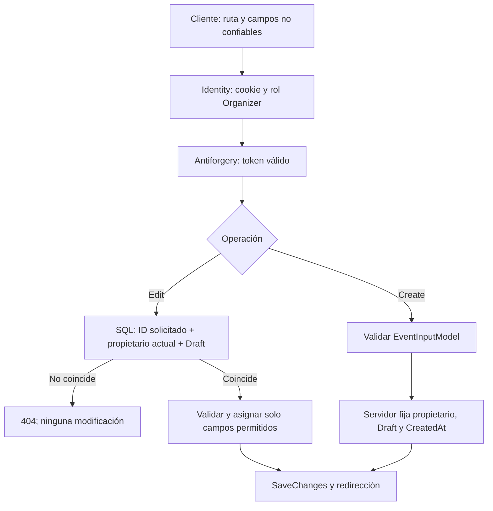
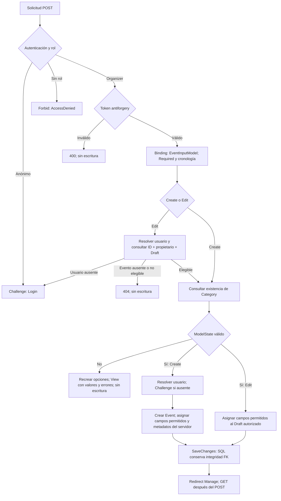

# Lesson 05 — Ejercicios

## 1. Location en Manage

`Manage.cshtml` añade únicamente un par `dt`/`dd` para Location dentro de `.event-meta`. No cambia entidad, esquema ni filtro del controlador.

En escritorio, etiqueta y ubicación aparecen en columnas; a 390 px se apilan y permanecen legibles sin desplazamiento horizontal. La definición semántica se conserva en ambos tamaños. Build correcto.

## 2. Límite de cronología

`Create_EndExactlyAtStart_RedisplaysErrorsWithoutChangingEvents` envía End exactamente igual a Start con cookie Organizer y token real. Comprueba respuesta 200, mensaje completo de cronología, valores compañeros, opciones Academic y comparación del evento existente, además del conteo inalterado.

El caso guiado con End anterior a Start y el caso independiente con igualdad se rechazan: la condición válida es estrictamente End > Start.

## 3. Manipulación de propiedad y campos protegidos

`OwnershipAndProtectedFields_TamperingCannotChangeEitherOwnersDraft` prepara dos Organizers reales con un Draft cada uno. El primero envía un POST Edit contra el ID del segundo: 404; ambas instantáneas permanecen iguales. Luego envía Create con OrganizerId ajeno y Status Published: redirige a Manage, inserta únicamente el nuevo Draft del usuario autenticado y conserva ambos Drafts previos. También compara CreatedAt con el reloj del servidor.

## 4. Diseño de validación

| Regla | Frontera responsable | Rechazo |
| --- | --- | --- |
| Campo obligatorio | Atributos del input model y ModelState | Formulario con error, sin asignar ni guardar. |
| Cronología | `IValidatableObject` | Error en EndDateTime y resumen. |
| Category existente | Consulta del controlador a SQL Server | Error de Category; reconstruir opciones. |
| Propietario autenticado | Identity y consulta de recurso | Challenge si no hay usuario; 404 si recurso ajeno. |
| Elegibilidad Draft | Predicado de Edit GET y POST | 404 antes de mutar. |
| Integridad FK | Restricciones SQL Server existentes | SQL rechaza referencia inválida; no sustituye feedback del formulario. |
| Antiforgery | Filtro MVC y token del formulario | 400 antes de ejecutar la acción. |

Refactorización propuesta, sin implementarla: extraer las siete asignaciones editables a un método privado que reciba EventInputModel validado y Event autorizado. Create seguiría fijando propietario, Draft y CreatedAt; Edit conservaría su consulta y rechazo antes de llamar al método. Reduce duplicación, pero obliga a mantener explícitas las precondiciones de validación y autorización; para siete campos, las asignaciones actuales facilitan su revisión.

Checklist para evaluar esa propuesta: conservar los POST válidos, rechazo de required/cronología/capacidad/Category, repoblación y valores retenidos, metadatos protegidos, 404 de otro dueño/Published/Cancelled, rechazo sin token, estado SQL sin cambios tras errores y regresión de catálogo y cuentas.
