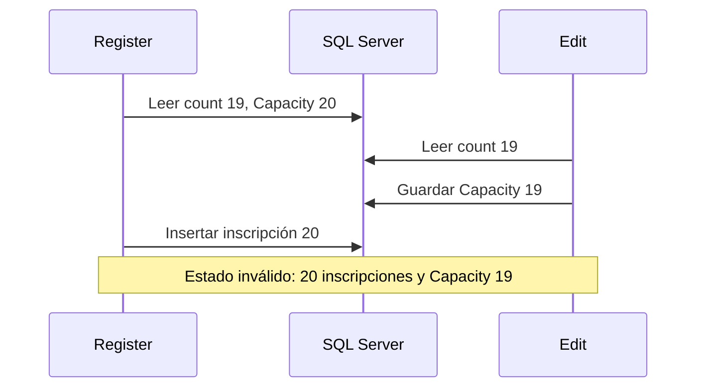

# Lesson 07 — Ejercicios

## 1. Evento Cancelled

`RegistrationServiceTests.CancelledEvent_IsUnavailable` prepara un Cancelled futuro y una cuenta sin inscripción. Llama al servicio real y espera Unavailable; un contexto nuevo confirma cero Registrations. El filtro de clase usa SQL Server LocalDB y migraciones reales, igual que el resto de pruebas.

## 2. Exactamente al inicio

Predicción: Start == now ya no cumple Start > now. Register debe devolver Unavailable y Cancel debe conservar la inscripción.

`Register_ExactlyAtStart_LeavesRowsUnchanged` mantiene End dos horas después y fija Start al reloj UTC−04: de cero inscripciones a cero. `RegistrationCancellation_StartBoundaryAndCancelledEvent(0, false)` comienza con una inscripción propia y verifica la redirección, el mensaje de rechazo y la permanencia de esa fila con un contexto nuevo. Los casos adicionales comprueban pasado y Cancelled antes del inicio, donde cancelar sí está permitido.

## 3. Invariante compartida

Invariante: número de inscripciones actuales del Event ≤ Capacity persistida.

Sin coordinación, ambos leen 19 inscripciones y Capacity 20:



Con coordinación, el orden del lock decide qué solicitud puede completar su cambio:

```mermaid
sequenceDiagram
    participant R as Register
    participant DB as Event con UPDLOCK/HOLDLOCK
    participant E as Edit
    alt Register obtiene primero el lock
        R->>DB: BEGIN; bloquear; releer count 19, Capacity 20
        E->>DB: BEGIN; solicitar mismo lock; esperar
        R->>DB: Insertar inscripción 20; COMMIT
        DB-->>E: Lock concedido; count actual 20
        E->>DB: Capacity 19 inválida; ROLLBACK y error
        Note over R,E: Resultado: count 20, Capacity 20
    else Edit obtiene primero el lock
        E->>DB: BEGIN; bloquear; releer count 19
        R->>DB: BEGIN; solicitar mismo lock; esperar
        E->>DB: Guardar Capacity 19; COMMIT
        DB-->>R: Lock concedido; count 19, Capacity 19
        R->>DB: Full; ROLLBACK sin insertar
        Note over R,E: Resultado: count 19, Capacity 19
    end
```

Las pruebas guiadas cubren los dos órdenes y solicitudes HTTP liberadas juntas; utilizan Capacity 2 y count 1 para el mismo razonamiento. La prueba de último cupo usa dos usuarios y contextos independientes.

## 4. Responsabilidades de las restricciones

| Invariante | Autoridad | Intento inválido | Evidencia de rechazo |
| --- | --- | --- | --- |
| Un par UserId/EventId actual | Índice único SQL | Insertar segundo par idéntico directamente con EF | `SqlConstraints_RejectDuplicatePairOrMissingEvent(true)`: error SQL 2601/2627; contexto nuevo conserva una sola fila. |
| Event de la inscripción existe | FK SQL | Insertar Registration con EventId inexistente | Mismo test, caso false: error SQL 547; cero filas persistidas. |
| Count ≤ Capacity | Transacción del servicio y lock compartido con Edit | Dos usuarios compiten por Capacity 1 | Un Success, un Full; una fila; comparación SQL de count y Capacity. |
| Draft con inscripción no se elimina | DeleteConfirmed consulta actual bajo lock; FK Restrict complementaria | Draft con una Registration preparada en fixture | `DraftDelete_WithRegistration_IsRefused`: feedback de rechazo y ambas filas conservadas. |

Los dos casos de restricciones son aserciones negativas independientes de los ejemplos guiados. Una FK no impone la capacidad; un índice único no impide que usuarios distintos excedan el cupo.

## 5. Migración y límite del cambio

Se revisaron Up, Down y snapshot de `20261116160410_AddParticipantRegistrations`: únicamente tabla Registrations, Id, UserId, EventId, CreatedAt, FK restrictivas, índice EventId y único UserId/EventId. Down elimina esa tabla. Se mantienen constraints de Event y migraciones anteriores; no se regeneran tablas Identity.

Index conserva su consulta, búsqueda, orden y paginación 10/25/50; su View añade solo el alert de indisponibilidad. Details cambia al modelo de disponibilidad, manteniendo Published/Cancelled. Edit POST y Delete POST comparten el lock del Event con Register. Las asignaciones de propietario y estado continúan bajo control del servidor. Participant conserva el nombre autenticado y añade los enlaces pedidos; su prueba se adapta al nuevo párrafo indicado por Lesson 07.

Se reutilizan `IsolatedSqlServerDatabase`, migraciones reales y reloj fijo UTC−04. Se revisa `git diff --check` y la lista staged; no se incorporan contraseñas reales, bases de datos, binarios ni helpers temporales. Commit de cierre: `Lesson 07: Implemented and Verified`.
