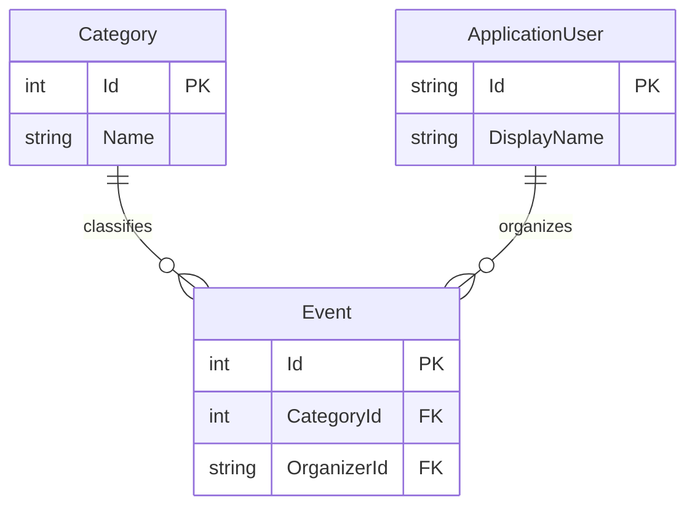
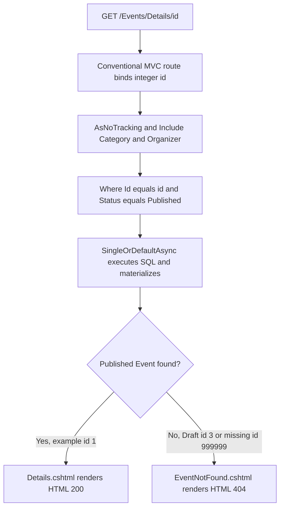

# Lesson 02 — Exercise deliverables

## Persistence boundary

`ApplicationUser` maps to `AspNetUsers`. Both foreign keys use restricted deletes.
The Event row stores the Category and Organizer IDs; navigation properties are
C# references loaded by EF Core, not entire objects stored as extra Event columns.

Observed on 2026-11-15: IDs 1 and 2 return their persisted Published Details;
Draft ID 3 and missing ID 999999 return the same controlled HTML 404. The query
loads related rows before Razor renders the resource.

## Query composition and temporary eligibility change

Before materialization, `ToQueryString()` describes a SELECT joined to Categories,
with `WHERE Status = 1 AND StartDateTime > @now`, followed by
`ORDER BY StartDateTime, Id`. The executed EF command log shows the same
predicate/order. `ToListAsync()` executes and creates the Event list.

Baseline browser result: Library Research Night, then Career Networking Lunch.
After completing the seed exercise: Study Skills Workshop is the third entry.

For the diagnostic exercise, the Published predicate was removed temporarily
from the actual `Index()` query. The focused regression failed as expected:
Draft Planning and Cancelled Mixer were included. The past and exact-now rows
were still excluded by `StartDateTime > now`. The predicate was restored in a
`finally` block, and the complete final suite passed. No broadened query was
committed. This demonstrates that public eligibility is enforced by the
server-side database query, rather than hidden by Razor.

## Seed extension

The initializer now includes Study Skills Workshop, Published, starting at
`today.AddDays(60).AddHours(16)`, ending one hour later, with Capacity 40 and
existing Academic/seed-organizer references. The location and description are
sample text, since the exercise does not prescribe their exact values.

Observed in the browser after a normal restart: Library Research Night
(2026-12-15), Career Networking Lunch (2027-01-04), Study Skills Workshop
(2027-01-14, 16:00–17:00, 40 places). IDs 1–5 remained unchanged; the workshop
was added as ID 6. Refreshing retained this order.

`DevelopmentSeedTests` covers empty, unrelated-owner/partial-category, and
preexisting seed-owner scenarios. Each runs the initializer twice, using a
fresh migrated SQL Server fixture. A fourth case starts from the original five
rows in another fixture, then runs the extended initializer twice. It checks
that only the workshop is added, no duplicate appears, and existing IDs/dates
remain unchanged. Changing the seed recipe inserts missing stable sample
titles; it does not update an existing matching sample row.

## Additional regression and its boundaries

`Details_Published_ReturnsEventWithCategoryAndOrganizer` arranges one Published
Event with related rows in a fixture-owned migrated database, invokes Details
through a controller with an HTTP context, and asserts the ID, title, loaded
Category/Organizer and status 200. The browser checks complement it by verifying
the routed request, Razor HTML, layout and navigation.

`SaveChanges_ZeroCapacity_IsRejectedAndNotPersisted` attempts a zero-capacity
insert, expects `DbUpdateException`, then checks with a fresh context that no
Event was persisted. This checks SQL Server enforcement of the migrated
constraint. It does not establish form validation behavior, which is future work.

Every fixture uses a generated GUID database name, applies the real migration,
disposes contexts, releases its own connection pool and drops its exact owned
database. It never reads or drops the Development application database.

Final execution: 8 passed, 0 failed, 0 skipped. See traceability for environment
and manual observations. Source changes remain local; no commit or push was made.
